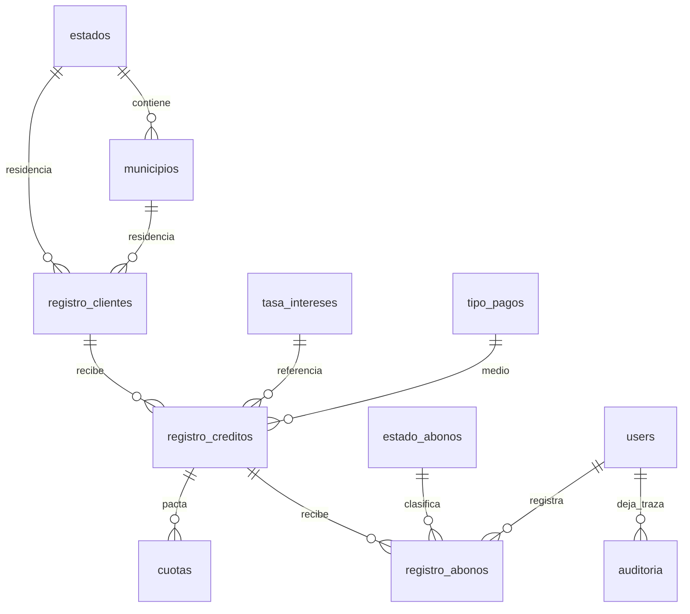

# Modelo en Cascada: documentos de esta versión

## 1. Análisis

Fuente: PDF de análisis de requisitos entregado por el usuario, páginas 7–8 (RF01–RF25 y RNF01–RNF20). Alcance del encargado: administrar clientes, créditos, abonos e historiales. Los clientes no acceden. El texto de implementación añade autenticación, calendarios, cancelación, respaldo y diseño. La imagen guía estilo, sin reproducir su contenido financiero.

Supuesto acordado en las instrucciones: monto total pactado como total a cobrar; la tasa no aplica una fórmula automática. La base SQL original no define cantidad de cuotas ni relación geográfica. Se registran explícitamente en el esquema nuevo. La aceptación académica de fases y la revisión con el usuario final no se presumen completadas por la implementación.

## 2. Diseño

MVC: rutas nombradas y middleware `auth`; controladores de autenticación, home, clientes, créditos, abonos y catálogos; Form Requests para altas/modificaciones; `CreditoService` centraliza cálculo en centavos, calendario, transacciones e historial. Eloquent configura nombres, claves y timestamps. El layout compartido carga Bootstrap local y CSS propio; los componentes Blade reúnen formularios, tablas, etiquetas y alertas.

Dinero DECIMAL(14,2), tasa DECIMAL(7,4), teléfono VARCHAR(20), CP VARCHAR(5). Estado de crédito derivado de saldo/fecha y separado de estados geográficos. Cuotas separadas de abonos reales. Abonos con token único y par único crédito/consecutivo. Cancelación lógica; clientes con activo. Auditoría de altas, cambios de cliente/crédito y movimientos. Claves RESTRICT para historial; cuotas se regeneran solo sin abonos.

Flujo de pago: autenticación → selección de crédito → saldo/importe/resultante → confirmación → transacción con bloqueo del crédito → verificar token y saldo → insertar abono y auditoría → comprobante. Cancelación bloquea en el mismo orden (crédito, abono) y conserva la fila.

## 3. Implementación

Código presente en app/, database/, routes/, resources/views/ y public/css, public/js. Migraciones para instalación vacía y adaptador que conserva el SQL original vacío. Pruebas y evidencias descritas en pruebas.md, con limitaciones en trazabilidad.md.

## 4. Despliegue

Instalación local de MariaDB efectuada, esquema anterior vacío conservado. README explica XAMPP y publicación exclusiva de public. Base independiente para pruebas funcionales en navegador y recuperación; no sustituye una aceptación en el equipo definitivo de operación. El despliegue en producción/red y la disponibilidad operacional no se certifican.

## 5. Mantenimiento

Revisar logs y respaldos, comprobar restauraciones periódicas, repetir pruebas tras modificar reglas, conservar historial financiero. Definir intereses antes de añadirlos. Validar usabilidad con encargados y medir volumen esperado del negocio. No hay evidencia de una fase futura de mantenimiento completada ni de aceptación formal de las fases académicas.
